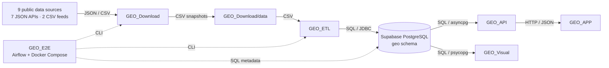

# GEO_APP — System Flow view

The **System Flow** view (`/system-flow`) is a responsive architecture map of the
six GEO repositories, the nine public data sources and the technologies they use.
It sits directly after Overview in the sidebar and before Data Source Files and
Data Quality. The app renders the pipeline as a vertical flow that reflows with
the window width.

The graph is data-driven from [`src/data/systemFlow.js`](src/data/systemFlow.js)
and rendered by
[`src/components/SystemFlowDiagram.jsx`](src/components/SystemFlowDiagram.jsx).
No API request is made: the map describes the deployed pipeline, not live data.
The Mermaid diagram below summarises the same pipeline; the app renders it as a
responsive vertical flow. Use a Mermaid-enabled renderer such as GitHub, GitLab
or a VS Code Markdown extension.

## Pipeline at a glance

## Repositories

| Repository | Role | What it does |
|------------|------|--------------|
| **GEO_E2E** | Orchestration | Airflow 3.3.2 DAG (`geo_pipeline`) runs download and ETL jobs as BashOperator subprocesses. Docker Compose builds and runs the Airflow/Spark image plus the API, React and Streamlit containers. Airflow metadata lives in the Supabase `geo_airflow` schema. |
| **GEO_Download** | Data acquisition | Fetches nine public APIs/feeds, reverse-geocodes rows, maintains reference CSVs and writes dated snapshots to `GEO_Download/data/<Source>/`. |
| **GEO_ETL** | Transformation | PySpark 3.5.5 casts, deduplicates and enriches the CSV snapshots, writes plain and `_etl` tables to the `geo` schema, builds `union_etl`, records `data_quality`, publishes `data_source_files`, and creates the 17 union views. |
| **GEO_API** | Serving | FastAPI + Uvicorn REST layer over the `geo` schema. Serves data-quality, data-quantity, data-source-file and event-count JSON endpoints. |
| **GEO_APP** | Presentation | This React 18 dashboard. Consumes GEO_API JSON and renders quality, quantity, source-file and event views. |
| **GEO_Visual** | Analytics | Streamlit dashboards that read the `geo` views directly from Supabase PostgreSQL with SQLAlchemy/psycopg 3 (read-only SQL, no GEO_API hop). |

## Data sources and transfer formats

| Source | Format | Endpoint / feed | Destination |
|--------|--------|-----------------|-------------|
| USGS Earthquake | CSV | FDSN event query (`format=csv`) | `GEO_Download/data/USGS_Earthquake/` |
| GDACS | JSON | GDACS disaster alert REST API | `GEO_Download/data/GDACS/` |
| NASA EONET | JSON | EONET API v3 | `GEO_Download/data/EONET/` |
| Open-Meteo Flood | JSON | Flood API | `GEO_Download/data/OpenMeteo_Flood/` |
| USGS NWIS | JSON | WaterServices + NWS gauge API | `GEO_Download/data/USGS_NWIS/` |
| Avalanche.org | JSON | Avalanche.org map-layer API | `GEO_Download/data/Avalanche_ORG/` |
| IBTrACS | CSV | NOAA IBTrACS best-track CSV | `GEO_Download/data/IBTrACS/` |
| USGS Volcano | JSON | HANS notices + NCEI HazEL API | `GEO_Download/data/USGS_Volcano/` |
| NIFC | JSON | WFIGS ArcGIS FeatureServer | `GEO_Download/data/NIFC/` |

The two arrows from the source panel to GEO_Download carry **JSON** (7 APIs) and
**CSV** (2 feeds). Everything after GEO_Download is CSV until GEO_ETL writes to
PostgreSQL over **SQL/JDBC**. GEO_API reads with **SQL/asyncpg**, GEO_APP talks
**HTTP/JSON**, and GEO_Visual reads with **SQL/psycopg**.

## Relationship inventory

| From | To | Badge | Meaning |
|------|----|-------|---------|
| Data sources | GEO_Download | JSON | 7 public APIs return JSON |
| Data sources | GEO_Download | CSV | USGS Earthquake and IBTrACS return CSV |
| GEO_Download | `data/` CSV store | CSV | Dated snapshots and reference lookups |
| `data/` CSV store | GEO_ETL | CSV | PySpark reads the snapshots |
| GEO_ETL | Supabase PostgreSQL | SQL | JDBC writes `geo.*` tables and metrics |
| Supabase PostgreSQL | GEO_API | SQL | asyncpg reads the `geo` schema |
| GEO_API | GEO_APP | HTTP + JSON | Browser calls REST endpoints |
| Supabase PostgreSQL | GEO_Visual | SQL | psycopg reads the `geo` views |
| GEO_E2E | GEO_Download | CLI | Airflow runs the download subprocess |
| GEO_E2E | GEO_ETL | CLI | Airflow runs ETL subprocesses |
| GEO_E2E | Supabase PostgreSQL | SQL | Airflow metadata in `geo_airflow` |

## Technology inventory

| Repository | Technologies |
|------------|--------------|
| GEO_E2E | Apache Airflow 3.3.2 (LocalExecutor), Airflow UI (`:8090`), Docker Compose, Docker, PySpark 3.5.5 / Spark standalone, Anaconda, Supabase Postgres (`geo_airflow`), Pydantic 2, Python 3.11 |
| GEO_Download | Python 3.11, requests, Pydantic 2, CSV, pytest, Ruff, mypy, tox |
| GEO_ETL | PySpark 3.5.5, Spark standalone, Supabase Postgres (JDBC), Pydantic 2, pytest, Ruff, mypy, tox |
| GEO_API | FastAPI, REST API, Uvicorn, Pydantic 2, SQLModel + SQLAlchemy 2 async, Supabase Postgres (asyncpg), pytest, Ruff, mypy, tox |
| GEO_APP | React 18, Vite, React Router 6, Bootstrap 5, Chart.js 4, Vitest, React Testing Library |
| GEO_Visual | Streamlit, pandas, Plotly, SQLAlchemy 2, Supabase Postgres (psycopg 3), Pydantic 2, pytest, Ruff, mypy, tox |

The diagram uses the logos available under `src/assets/logos/`:

- `data-source/` — one logo per public source.
- `technology/folder_no_text_symbol.png` — every `GEO_*` repository node and the
  `data/` CSV store.
- `technology/database_no_text_symbol.png` — the database node, combined with the
  Supabase and PostgreSQL logos and labelled **Supabase PostgreSQL**.
- `technology/streamlit_no_text_logo.png` — GEO_Visual's Streamlit tile.
- `technology/` also contains the requests, Pydantic, PySpark, JDBC, REST,
  SQLModel, SQLAlchemy, asyncpg, React Router, Vite, Chart.js, Bootstrap,
  pandas, Plotly and psycopg logos used by the repository cards.

### Label rule

Every source and technology tile renders its human-readable name underneath the
image. The `no_text` assets are preferred because they keep the image itself free
of a duplicate wordmark; wordmark logos get a reinforcing label as well. The
`folder_no_text_symbol` and `database_no_text_symbol` nodes always get visible
text.

## Layout and tests

- Responsive vertical flow: the diagram reflows with the window width instead of
  using a fixed pixel canvas.
- Wide screens use a two-column card layout (description left, technology tiles
  right); below 900 px the cards stack and technology tiles wrap.
- The source grid uses `auto-fit` columns, and the GEO_API/GEO_APP and
  GEO_Visual branches sit side by side on wide screens and stack on narrow ones.
- Connector badges are colour-coded: CSV green, JSON amber, SQL blue, HTTP pink,
  CLI grey.
- Unit tests: [`src/data/systemFlow.test.js`](src/data/systemFlow.test.js),
  [`src/components/SystemFlowDiagram.test.jsx`](src/components/SystemFlowDiagram.test.jsx)
  and [`src/views/SystemFlowView.test.jsx`](src/views/SystemFlowView.test.jsx).
- Route/order tests: [`src/routes.test.js`](src/routes.test.js) and
  [`src/App.test.jsx`](src/App.test.jsx).
